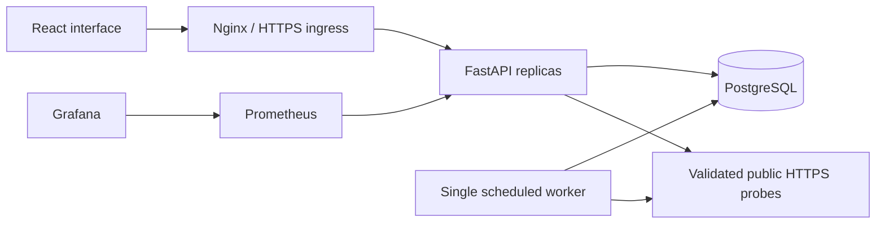

# Vigil

**See the signal. Own the response.**

An open-source reliability workspace for developers who want service health, incident response, and recovery work in one place. Built with Python, React, and PostgreSQL, with an original animated interface and a reproducible DevOps delivery path.

[](https://github.com/ReaperXD67/vigil/actions/workflows/ci.yml)
[](LICENSE)


## What works

- **Service monitoring:** real public HTTPS checks, latency history, retained availability, and an optional scheduled worker. Targets are validated and pinned to public IPs; redirects and private networks are blocked.
- **Incident response:** severity, affected service, investigation-to-resolution workflow, timestamped updates, and downloadable Markdown postmortems generated from the actual timeline.
- **Recovery tasks:** a keyboard-accessible board, priority, incident links, editing, deletion, filtering, and completion.
- **Private workspaces:** database-backed sessions, scrypt passwords, owner-scoped data, and a separate disposable demo for each visitor. Demo telemetry is clearly labeled and cannot trigger external probes.
- **Public status pages:** explicitly opted-in services only. Endpoint URLs, private notes, tasks, and account details stay private.
- **Portable data:** JSON workspace exports, a durable activity trail, and `Ctrl/Cmd+K` search.
- **Responsive interface:** original particle constellation, Lenis/GSAP landing motion, accessible dialogs, self-hosted fonts, and reduced-motion support.

## Run locally

With Docker Engine and Compose v2 running:

```sh
git clone https://github.com/ReaperXD67/vigil.git
cd vigil
cp .env.example .env
# Replace POSTGRES_PASSWORD in .env with a long random value.
docker compose up --build -d
```

Open **http://localhost:3000** and choose **Explore the live demo**, or create an account to connect real HTTPS services. The database persists in the `vigil_postgres-data` volume. Ports bind to localhost.

```sh
docker compose ps
docker compose logs -f backend
docker compose down
```

`down` preserves the database volume. `down -v` deletes local data; use it only when intentionally resetting the stack.

For development without Docker, follow the [backend](backend/README.md) and [frontend](frontend/README.md) guides. SQLite is supported for local work; PostgreSQL is the deployment database.

## Architecture



The API exposes `/health`, DB-aware `/ready`, Prometheus `/metrics`, Swagger `/docs`, and resource routes under `/api`. The production edge restricts metrics to the internal monitoring path. See the [API contract](backend/API.md).

## Engineering and verification

GitHub Actions runs Python tests, frontend type-check/build/tests, PostgreSQL migration/rollback checks, nonroot container builds, and a real Compose persistence smoke test. Both images must pass Trivy with **zero HIGH or CRITICAL findings** before SHA-tagged images are published to GHCR. Early incremental commits may fail while implementation is in progress; use the current commit’s run as evidence.

Verified in [CI run 38700091001](https://github.com/ReaperXD67/vigil/actions/runs/38700091001): **73 backend tests, 7 frontend tests**, production builds, both PostgreSQL migrations and rollback/reapplication, nonroot containers, and session/task persistence across a backend restart. Both images passed the strict security gate and are publicly pullable from GHCR at commit `fb0a8a71b0f6ef563eed206f3f98a54fe4577347`.

Browser checks also verified account registration/login, a real HTTPS probe, incident resolution and postmortem download, task movement, command search, JSON export, and public-status privacy. Desktop and mobile interfaces were inspected. Terraform validation and Helm/schema checks passed locally. See the [verification record](docs/VERIFICATION.md) for evidence and limits.


**Hosting status:** AWS access currently needs reauthentication. No live deployment URL, EKS apply/destroy evidence, or live monitoring result is claimed yet. Infrastructure files alone are not deployment proof.

## Deploy and operate

- [Deployment guide](docs/DEPLOYMENT.md): lower-cost EC2/K3s profile, HTTPS, optional EKS path, and teardown.
- [Operations guide](docs/OPERATIONS.md): backup/restore, rollout, monitoring, and isolated failure exercises.
- [Helm guide](helm/README.md): PostgreSQL, migration gate, two API/frontend replicas, worker, probes, and HPA.
- [Monitoring guide](monitoring/README.md): Prometheus/Grafana configuration and real metric queries.
- [Requirement evidence](docs/REQUIREMENTS.md): original capstone requirements and verified versus unexecuted work.
- [Contributing](docs/CONTRIBUTING.md) and [security boundaries](SECURITY.md).

The ongoing hosting profile avoids the EKS control-plane cost. Full EKS remains an explicit opt-in capstone path. AWS free credits depend on the account, region, service eligibility, and remaining balance; this project does not promise permanent free hosting.

## Current limits

Vigil is a small-team, single-workspace-per-account application. It is not a distributed global probe network or an uptime SLA. Email verification/recovery, team invitations, external notifications, billing, and AI-generated diagnoses are not implemented. Postmortems are deterministic exports. No payment or paid model service is required.

Demo workspaces expire after 24 hours by default. Check history, workspace capacity, and request sizes are bounded. Read [backend configuration](backend/README.md) before exposing a self-hosted installation.

## Built in the open

Original product and code, using the [session 21 Python capstone](https://github.com/Nency-Ravaliya/devops-heros/tree/main/session21-python) as the engineering baseline. Design references and library attribution are in [DESIGN.md](DESIGN.md). No paid templates or proprietary assets are bundled.

MIT licensed. Contributions that improve reliability, accessibility, and real-world operation are welcome.
