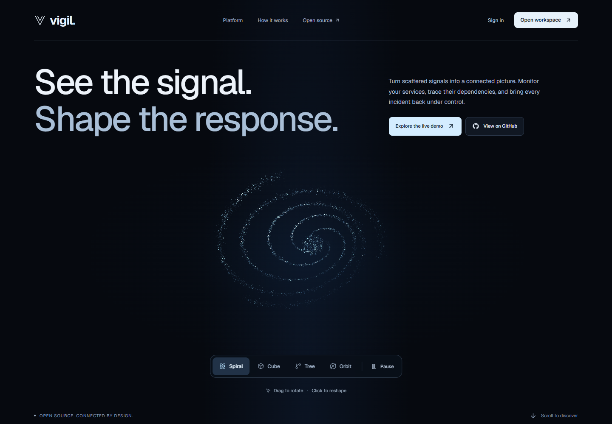
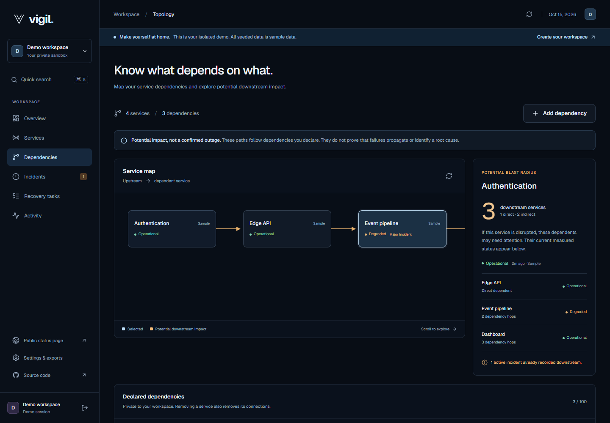
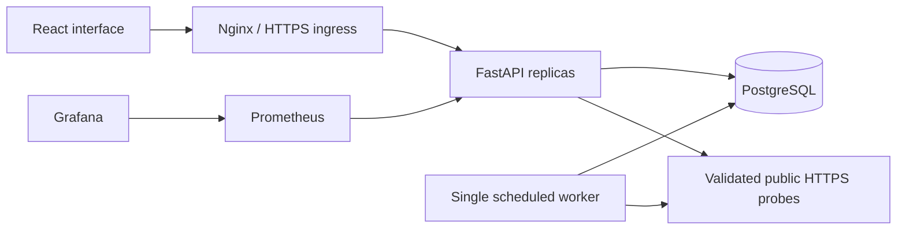
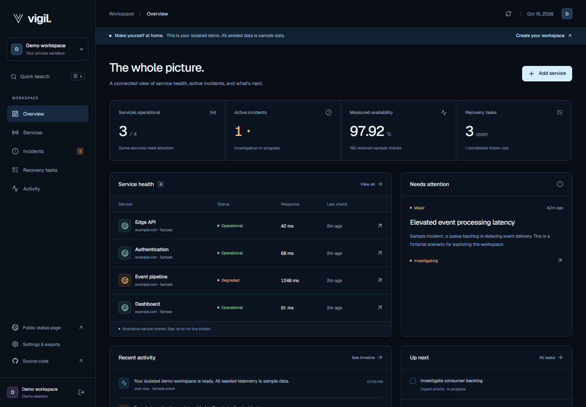

# Vigil

**See the signal. Shape the response.**

An open-source reliability workspace for developers who want service health, incident response, and recovery work in one place. Built with Python, React, and PostgreSQL, with an original animated interface and a reproducible DevOps delivery path.

[](https://github.com/ReaperXD67/vigil/actions/workflows/ci.yml)
[](LICENSE)

**[Try Vigil live](https://vigil.13-127-163-58.sslip.io)** · [Explore an isolated demo](https://vigil.13-127-163-58.sslip.io/app?demo=1) · [Deployment evidence](docs/VERIFICATION.md)



## What works

- **Service monitoring:** real public HTTPS checks, latency history, retained availability, and an optional scheduled worker. Targets are validated and pinned to public IPs; redirects and private networks are blocked.
- **Dependency analysis:** declare upstream connections, select a service, and trace direct and indirect dependents alongside current health and active incidents. Connections persist, reject cycles, and remain private to your workspace.
- **Incident response:** severity, affected service, investigation-to-resolution workflow, timestamped updates, and downloadable Markdown postmortems generated from the actual timeline.
- **Incident rehearsal:** explore three clearly labeled simulations, inspect affected services, play or scrub the timeline, share a scenario at an exact point, and export the exercise as Markdown. No external requests or real incidents are created.
- **Recovery tasks:** a keyboard-accessible board, priority, incident links, editing, deletion, filtering, and completion.
- **Private workspaces:** database-backed sessions, scrypt passwords, owner-scoped data, and a separate disposable demo for each visitor. Demo telemetry is clearly labeled and cannot trigger external probes.
- **Public status pages:** explicitly opted-in services only. Endpoint URLs, private notes, tasks, and account details stay private.
- **Portable data:** JSON workspace exports, a durable activity trail, and `Ctrl/Cmd+K` search.
- **Interactive particle sculpture:** 10,400 GPU-rendered points morph between a spiral, cube, branching tree, and orbit. Click to reshape, drag to rotate, or use the keyboard. Responsive density, pause controls, reduced-motion support, and a Canvas2D fallback keep the experience accessible.



## Run locally

With Docker Engine and Compose v2 running:

```sh
git clone https://github.com/ReaperXD67/vigil.git
cd vigil
cp .env.example .env
# Replace POSTGRES_PASSWORD in .env with a long random value.
docker compose up --build -d
```

Open **http://localhost:3000** and choose **Explore the live demo**, or create an account to connect real HTTPS services. The database persists in the `vigil_postgres-data` volume. Ports bind to localhost.

```sh
docker compose ps
docker compose logs -f backend
docker compose down
```

`down` preserves the database volume. `down -v` deletes local data; use it only when intentionally resetting the stack.

For development without Docker, follow the [backend](backend/README.md) and [frontend](frontend/README.md) guides. SQLite is supported for local work; PostgreSQL is the deployment database.

## Architecture



The API exposes `/health`, DB-aware `/ready`, Prometheus `/metrics`, Swagger `/docs`, and resource routes under `/api`. The production edge restricts metrics to the internal monitoring path. See the [API contract](backend/API.md).

## Engineering and verification

GitHub Actions runs Python tests, frontend type-check/build/tests, PostgreSQL migration/rollback checks, nonroot container builds, and a real Compose persistence smoke test. Both images must pass Trivy with **zero HIGH or CRITICAL findings** before SHA-tagged images are published to GHCR. Early incremental commits may fail while implementation is in progress; use the current commit’s run as evidence.

Verified in [CI run 38737987208](https://github.com/ReaperXD67/vigil/actions/runs/38737987208): **86 backend tests, 13 frontend tests, 10 spending-guard tests**, production builds, all three PostgreSQL migrations and rollback/reapplication, nonroot containers, and session/task/dependency persistence across a backend restart. Both images passed the strict security gate and are publicly pullable from GHCR at commit `1c2bcabfabb8572d91a81b2da9e28623aa8d970e`. The particle upgrade adds eleven geometry/projection tests, bringing the frontend suite to **24**; its exact delivery run is recorded in the verification guide.

Browser checks also verified account registration/login, a real HTTPS probe, incident resolution and postmortem download, task movement, command search, JSON export, and public-status privacy. Desktop and mobile interfaces were inspected. Terraform validation and Helm/schema checks passed locally. See the [verification record](docs/VERIFICATION.md) for evidence and limits.



**Hosting:** public HTTPS on AWS EC2/K3s with PostgreSQL, two API replicas, two frontend replicas, and a scheduled worker. Live checks exercised database restoration, isolated deployment failures, and HPA scaling **2 → 3 → 4 → 2**. Prometheus/Grafana were verified during a bounded operations exercise; the full monitoring stack is not kept running on the small host. See the [dated evidence and current revision](docs/VERIFICATION.md).

## Deploy and operate

- [Deployment guide](docs/DEPLOYMENT.md): lower-cost EC2/K3s profile, HTTPS, optional EKS path, and teardown.
- [Operations guide](docs/OPERATIONS.md): backup/restore, rollout, monitoring, and isolated failure exercises.
- [Helm guide](helm/README.md): PostgreSQL, migration gate, two API/frontend replicas, worker, probes, and HPA.
- [Monitoring guide](monitoring/README.md): Prometheus/Grafana configuration and real metric queries.
- [Requirement evidence](docs/REQUIREMENTS.md): original capstone requirements and verified versus unexecuted work.
- [Contributing](docs/CONTRIBUTING.md) and [security boundaries](SECURITY.md).

This deployment is constrained to the account's **AWS Free plan**. The deployment helper requires `FREE`/`ACTIVE` and positive finite USD credit before provisioning; a paid account with promotional credits is rejected. No account upgrade is authorized. The Free plan ends when its time or credits run out, so availability is temporary: the observed account expiry is **9 April 2027**, or earlier if credits run out. The deployment consumes credits and does not provide permanently free infrastructure. See [AWS's Free plan terms](https://docs.aws.amazon.com/awsaccountbilling/latest/aboutv2/free-tier-plans.html) and the [deployment boundary](docs/DEPLOYMENT.md).

EKS manifests remain available as reference infrastructure, but EKS apply/destroy is **unverified** and is not part of this account's authorized deployment.

## Current limits

Vigil is a small-team, single-workspace-per-account application. It is not a distributed global probe network or an uptime SLA. Dependency impact follows declared connections; it is not automatic root-cause detection. Email verification/recovery, team invitations, external notifications, billing, and AI-generated diagnoses are not implemented. Postmortems are deterministic exports. No payment or paid model service is required.

Demo workspaces expire after 24 hours by default. Check history, workspace capacity, and request sizes are bounded. Read [backend configuration](backend/README.md) before exposing a self-hosted installation.

## Built in the open

Original product and code, using the [session 21 Python capstone](https://github.com/Nency-Ravaliya/devops-heros/tree/main/session21-python) as the engineering baseline. Design references and library attribution are in [DESIGN.md](DESIGN.md). No paid templates or proprietary assets are bundled.

MIT licensed. Contributions that improve reliability, accessibility, and real-world operation are welcome.
