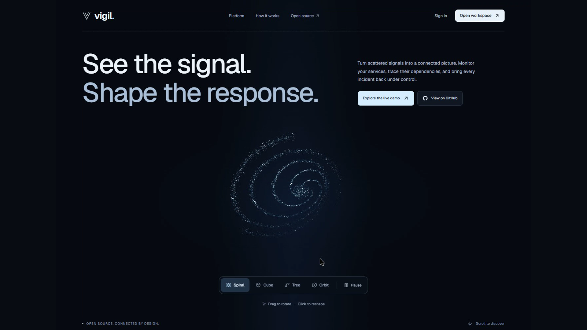

# Watch Vigil work

The presentation connects the product to its delivery evidence: an actual Git push, successful CI, Terraform, an isolated GitOps promotion, Kubernetes, and live observability.

**[Watch / download the MP4](https://github.com/ReaperXD67/vigil/releases/download/v1.1.0/vigil-walkthrough.mp4)** · **[PowerPoint](presentation.pptx)** · **[PDF](slides.pdf)** · **[Live application](https://vigil.13-127-163-58.sslip.io)**

The MP4 is a GitHub release asset so cloning the source does not download the full movie. The twelve-slide editable deck and PDF are committed here. See [video chapters, provenance, and reproduction](VIDEO.md), [slide notes](SLIDES.md), and the [submission checklist](SUBMISSION.md).

## What the evidence establishes

- A working Python/PostgreSQL reliability application with real HTTPS probes and a responsive React interface. Sample workspaces and incident rehearsals are labeled.
- Tests, migrations, container persistence, nonroot runtime, and a strict Trivy gate before full-SHA images are published.
- AWS EC2 with K3s and two public subnets. Argo CD manages a separate disposable preview; production remains Helm-managed.
- A bounded observability exercise. Temporary controllers, dashboards, and larger capacity are removed after capture.

**EKS is not deployed.** The account must remain on the AWS Free plan. Source validation and K3s evidence do not establish EKS provisioning or destruction. The live application is retained for review, so a full production `terraform destroy` is also not claimed. [Exact verification and limits](../docs/VERIFICATION.md).

## Reproduce the product

Follow the [root quick start](../README.md#run-locally), then explore the isolated demo. For the recorded operations, use the [GitOps](../gitops/README.md), [deployment](../docs/DEPLOYMENT.md), and [monitoring](../monitoring/README.md) guides. Never upgrade the AWS account to reproduce the demonstration.
