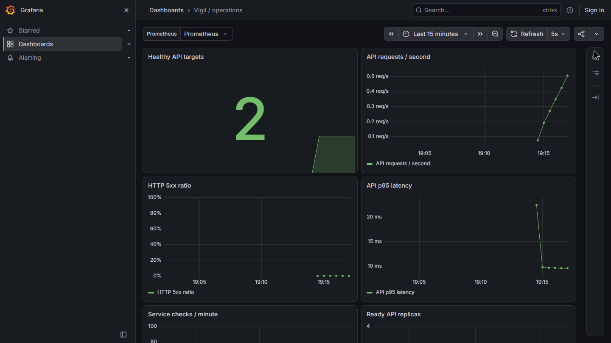

# Delivery verification

**Updated: 16 October 2026.** This record separates automated checks, real browser workflows, live AWS operations and remaining submission gaps. The [main README](../README.md) carries the public URL and current delivery summary.

The public release at [vigil.13-127-163-58.sslip.io](https://vigil.13-127-163-58.sslip.io) runs **`dbe40442fc324ea1393e121a65887ee697131619`**, Helm revision **10**, with database revision **`c5f6d1a2b390`**. The final host is **t3.small (2 GiB)**. The temporary GitOps and monitoring installations have been removed after recording their real behavior. This is a single-host EC2/K3s deployment under an active AWS Free account plan; EKS has not been provisioned.

## Automated checks and published images

[CI run 38908236938](https://github.com/ReaperXD67/vigil/actions/runs/38908236938) passed all four jobs for the exact deployed application revision. Publication followed the application tests, complete-stack checks and both strict container scans.

| Check | Observed result |
| --- | --- |
| Python API suite | **94 tests passed**, including authentication, tenant isolation, dependency cycles/concurrency, public privacy and status badges |
| Frontend | Production TypeScript/Vite build and **24 tests passed**, covering the API client, dependency graph and particle geometry |
| AWS spending guard | **10 offline tests passed**; provisioning requires an active Free plan and positive finite USD credits; paid, expired, unknown and malformed balances fail closed |
| PostgreSQL migrations | All three migrations applied; readiness, authenticated CRUD, dependencies, cycle rejection and deletion cascade passed; rollback to base and reapplication passed |
| Compose integration in CI | Actual Nginx/API/PostgreSQL services passed demo login, service/task workflows, export, metrics and logout |
| Persistence | Existing session, updated task and dependency survived a backend container restart; the persisted edge appeared in JSON export and disappeared after service deletion |
| Nonroot containers | Both application containers ran with nonzero user IDs |
| Image security | Trivy v0.76.0 reported **zero HIGH or CRITICAL findings** for both published images using that run's vulnerability database; unfixed findings are included and no exclusions weaken the gate |

The total is **128 tests**: 94 API, 24 frontend and 10 spending-guard cases. The [API report excerpt](../demo/evidence/api-test-excerpts.txt) records the JUnit result. The [Compose smoke check](../.github/scripts/compose-smoke.py) runs against the same images subsequently scanned and published. The scan result is a point-in-time gate, not a guarantee of no vulnerabilities. Lower severities remain outside this gate. Reports are retained in the linked run's `container-security-reports` artifact and [submission excerpts](../demo/evidence/ci-check-excerpts.txt).

| Public image tag | Verified manifest digest |
| --- | --- |
| `ghcr.io/reaperxd67/vigil-backend:dbe40442fc324ea1393e121a65887ee697131619` | `sha256:6f2e8883002a0a875085312993ff70a01839820dd70aa1a68c01cf637af15cc8` |
| `ghcr.io/reaperxd67/vigil-frontend:dbe40442fc324ea1393e121a65887ee697131619` | `sha256:0ee2062e60bff38f02d3c5af5c7a5ab5407ac1162cf8611aab9e751b9bfbc9eb` |

Anonymous registry manifest requests returned HTTP 200 for both images. Their public availability does not depend on local GitHub credentials. The [recorded CI screenshots](../demo/evidence/ci-complete.png) and [captured run data](../demo/evidence/ci-complete.json) identify the actual workflow.

## Local Compose and browser verification

Local Docker Desktop/WSL Compose verification succeeded on **16 October**, replacing the earlier host-startup limitation. `docker compose up --build -d --wait` returned zero with all three services healthy. The frontend was available at localhost:3000; the API used localhost:8001 for this check to preserve an existing development process on 8000. Both containers were nonroot, and PostgreSQL contained 12 tables including `alembic_version`. See the [actual command transcript](../demo/evidence/compose-verification.txt) and [local browser capture](../demo/evidence/compose-localhost.png).

Browser and API checks across the delivered revisions exercised:

- Registration, sign-in, session persistence, service creation, task changes, incident updates through resolution, structured postmortems and JSON export.
- A real HTTPS probe of `https://example.com`, cross-workspace `404`, private-service status-page privacy, and external-probe rejection for demo accounts. Verification services/tasks/incidents were deleted and sessions logged out. An empty generated registered account remains because account deletion is not implemented.
- Dependency creation/deletion persisting after reload, cycle rejection, cascade deletion and correct direct/indirect downstream impact. Existing workspaces are not backfilled with invented dependencies; only newly created demos receive the sample chain.
- The nested `/app/topology?demo=1` entry, shared incident-lab scenario/time, playback/pause and Markdown export. Lab events and demo measurements are visibly labeled simulations/sample data.
- The actual WebGL path with 10,400 points on desktop and 7,200 on mobile; shape, keyboard, pause and reduced-motion controls. The 390 px and 320 px document widths stayed within their viewports.
- Recovery from a blocked route chunk and an induced render exception through the route error boundary.
- On the **current public release**, the status badge returned HTTP 200 with SVG content and a 60-second cache header; its copy action worked without browser console errors. The [public badge capture](../demo/evidence/status-badge-live.png) records the feature.

The 15 October public API check measured one successful example.com response at 93.2 ms. That observation is not an uptime or performance guarantee. Potential dependency impact follows user-declared connections, not measured causality. [Production interface](../demo/evidence/product-live.png), [dependency view](assets/dependencies-live.png), and [local mobile view](assets/mobile.png) are evidence of different checks and should not be treated as synthetic monitoring of the platform itself.

## Actual infrastructure and production operations

The EC2 Terraform root owns a VPC, two public subnets in separate availability zones, routing, the single host, encrypted gp3 storage, IAM for SSM and one stable public address. Only the first subnet contains compute. On 16 October the reviewed nonempty plan added the second subnet and route association, and temporarily resized the existing host in place: **2 added, 1 changed, 0 destroyed**. The [sanitized plan](../demo/evidence/terraform-plan.txt) and [actual AWS VPC console](../demo/evidence/aws-vpc-console.jpg) document this EC2 root. No NAT Gateway, load balancer, RDS, EKS or paid-plan enrollment was created.

The Free-plan guard passed before remote deployment and capacity changes. It checks the actual account plan/status and positive finite credits; it does not upgrade the account. AWS Free-plan protection is time/credit limited, so continued availability is not perpetual. The cost estimate and account-policy boundaries are in [DEPLOYMENT.md](DEPLOYMENT.md).

The new application was deployed only after its exact CI revision passed. A PostgreSQL backup preceded the upgrade, the Alembic migration hook completed, and the frontend/backend/worker used the immutable published image tags. The frontend uses `Recreate` to prevent mixed-version asset responses; the two API replicas use a zero-surge rolling update to reduce peak memory on the budget host. A bounded frontend interruption is possible during upgrades.

The reviewed return plan changed only the instance type in place: **0 added, 1 changed, 0 destroyed**. AWS confirmed `t3.small`, running, the same public address and required IMDSv2. Six control-plane `/readyz` and public HTTPS `/ready` checks passed from **13:52:59 to 13:54:43 UTC on 16 October**; database readiness remained `ok`. Available memory ranged **423–461 MiB**. No restart counters increased during the window; existing counters include the controlled host reboots/startup. Frontend **2/2** and worker **1/1** remained ready. The HPA temporarily retained **3 healthy API replicas** after startup load, with **3–4% CPU / 75% target**, within its configured 2–4 range and normal downscale window.

At **13:57:55 UTC**, the HPA had returned naturally **3 → 2**, reporting “All metrics below target.” The final snapshot confirmed backend **2/2**, frontend **2/2**, worker **1/1**, public/control-plane readiness, **517 MiB** available memory and Helm revision **10**, with unchanged restart counters. The [fresh Kubernetes transcript](../demo/evidence/kubernetes.txt) captures this post-upgrade budget-host state. Only the production/system namespaces remain; the review namespaces and both Argo/monitoring CRD groups are absent. All temporary SSM forwarding processes exited. The Free/Active positive-credit guard passed again after return; no account upgrade occurred. A final Terraform plan reported **no changes** with exit code 0, and T3 CPU credits remained `standard`.

Production remains a single failure domain. Same-host backups are retained on encrypted EBS but are not an off-host disaster-recovery strategy. Earlier verification restored a checksum-verified baseline backup into a separate disposable database and removed that database afterward; production was not replaced. Scheduled off-host backups are not configured.

On 15 October, a bounded CPU exercise observed API HPA scale **2 → 3 → 4** and then return naturally **4 → 2**, enforcing the configured maximum. Broken-image and wrong-Service-selector exercises recovered inside an isolated temporary namespace, which was removed. These are observed demonstrations, not a claim of multi-node resilience or an exhaustive failure test.

## Recorded GitOps reconciliation

The temporary Argo CD installation used chart **10.10.5**, application **v3.5.5**, and the existing `helm/vigil` chart in the isolated `vigil-preview` namespace. Its project and namespace-scoped permissions excluded production, RBAC changes and Secret reads. Actual permission checks returned no production Deployment access, allowed preview Deployment updates and no preview Secret reads. The preview enforced Restricted Pod Security and used a separate disposable PostgreSQL database. All UI access used a private SSM tunnel; no public Argo ingress or administrator session was exposed.

The recording first captured **Synced / Healthy** at Git revision `dbe40442`. A subsequent [Git promotion `33f8e1f4e01e68a52922dcf4fd6f3e77edfe47af`](https://github.com/ReaperXD67/vigil/commit/33f8e1f4e01e68a52922dcf4fd6f3e77edfe47af) changed both preview image tags from the earlier baseline to tested application revision `dbe40442fc324ea1393e121a65887ee697131619`. Argo automatically reconciled from **13:37:27 to 13:37:42 UTC**, ran the migration, and finished **Synced / Healthy / Succeeded** with the new images. No manual sync or Helm application upgrade performed that promotion.

See the [actual promotion transcript](../demo/evidence/gitops-promoted.txt), [baseline capture](../demo/evidence/argocd-baseline.png), [promoted capture](../demo/evidence/argocd-promoted.png) and [reproduction guide](../gitops/README.md). After capture, the Application, controller, preview namespace/database/PVC, owned empty Argo CRDs and tunnel were removed. **Production remains Helm-managed; continuous production Argo reconciliation is not claimed.**

## Fresh Prometheus and Grafana evidence

On **16 October**, after the GitOps review was removed, the optional `kube-prometheus-stack` **92.7.0** and Grafana **13.2.4** were installed on temporary 4 GiB capacity. The actual Prometheus Targets page showed **all three application targets UP**: two API replicas and the singleton worker. The eight-panel **Vigil / operations** dashboard showed two healthy API targets and real request/latency series.

At 13:46:23 UTC, API queries observed approximately **0.413 requests/s** and **0.00961 s p95**. These short-window observations are not performance guarantees. At 13:46:55 UTC, a direct internal `/metrics` request returned actual counters and histogram values, including 97 requests, zero HTTP 5xx responses and 96 latency observations for the sampled API process. Metrics stay private; public `/metrics` routes are not exposed.

The [fresh Targets capture](../demo/evidence/prometheus-targets.png) and [query/target data](../demo/evidence/monitoring-live.json) support this recording. This live run verifies Grafana's corrected **512 MiB** limit, the 0–1 error ratio displayed as 0–100%, and the numeric checks-per-minute unit. It supersedes the older 15 October screenshot's incorrect axis formatting. Monitoring pods had zero restarts at capture.

After recording, monitoring was disabled in production Helm revision 10; the monitoring release/namespace, temporary anonymous Viewer access, both private tunnels and all ten empty owned monitoring CRDs were removed. The application continues to export internal metrics and its HPA uses Kubernetes Metrics Server. **Continuous Prometheus/Grafana hosting is not claimed.**

## Scope limits and reproducibility

The [local infrastructure validation record](../infra/validation.txt) covers both Terraform roots, Helm lint/render, standard Kubernetes schemas, monitoring/Argo rendering and script syntax. Custom resource schema validation is explicitly identified where skipped. Installers reject unowned existing review namespaces/CRDs instead of adopting them; cleanup checks ownership and refuses deletion while unrelated CRD instances remain.

The source repository is public and exceeds ten meaningful commits; the [current history](https://github.com/ReaperXD67/vigil/commits/main/) and [submission artifacts](../demo/SUBMISSION.md) preserve the delivery. Remaining explicit gaps are:

- **EKS was not provisioned or demonstrated.** The [real EKS console capture](../demo/evidence/aws-eks-not-provisioned.jpg) records its absence. The source-only EKS profile and live EC2/K3s environment do not satisfy a rubric that requires a running EKS cluster.
- **A full Terraform destroy was not executed**, because the requested public product remains hosted. Reviewed cleanup instructions are provided; destructive completion is not fabricated.
- GitOps and full monitoring were bounded demonstrations, then removed to preserve the Free account's credits and the 2 GiB host's memory.

See the [requirements ledger](REQUIREMENTS.md), [deployment guide](DEPLOYMENT.md), [operations guide](OPERATIONS.md) and [submission walkthrough](../demo/VIDEO.md) for the matching source, workflows and evidence.
