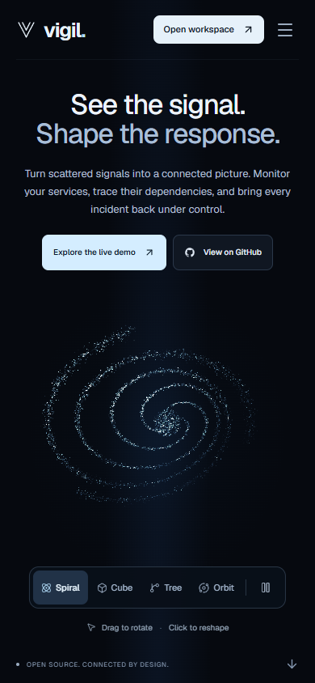
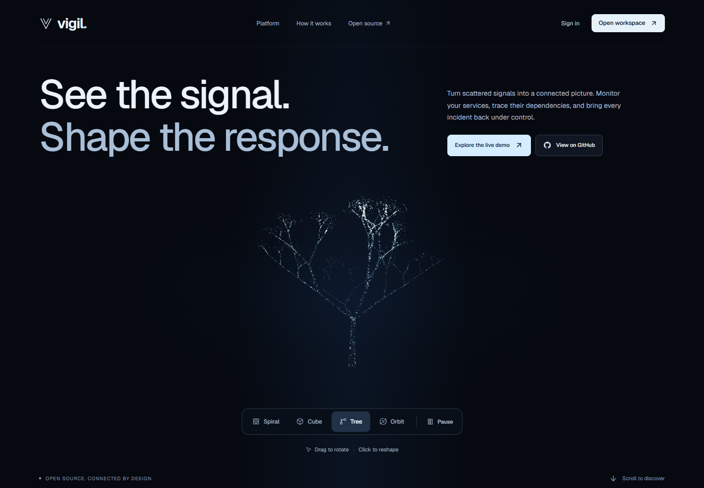
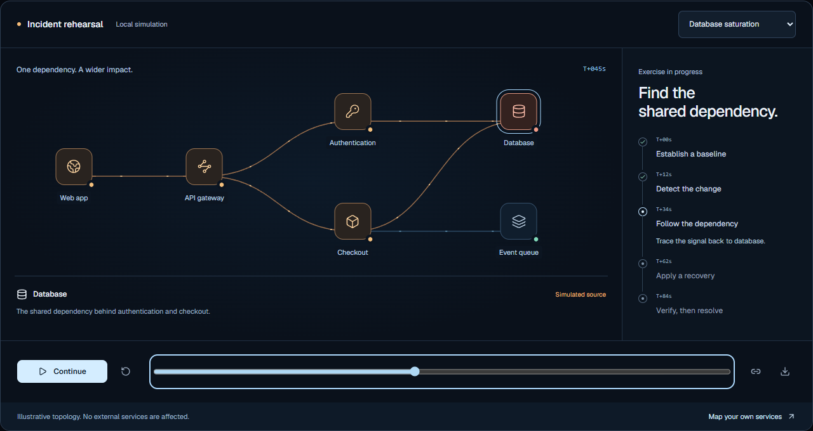
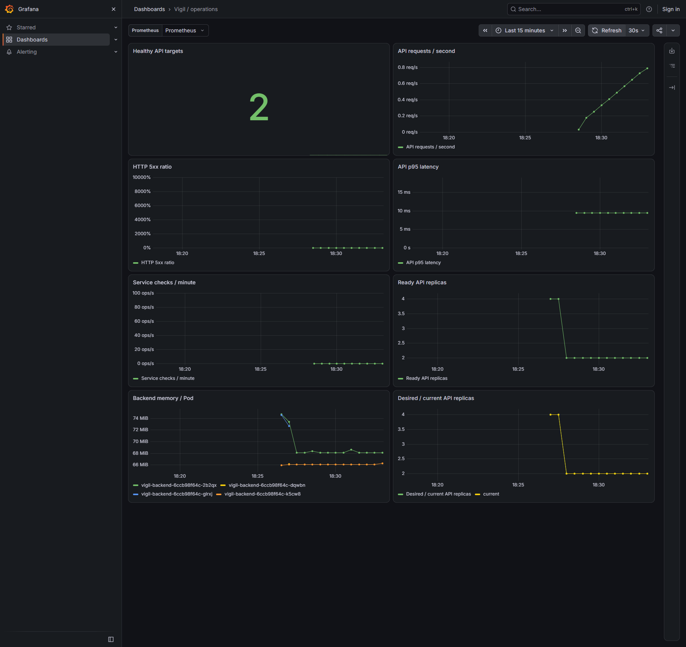

# Delivery verification

**Date:** 15 October 2026. This record separates exact CI revisions, local browser checks, and observed AWS operations. The [main README](../README.md) carries the current public URL and deployed revision.

The source repository is public and exceeds the assignment's ten-commit requirement. Its [captured history](assets/github-history.png) shows 11 meaningful commits through `9370cf8`; the [current history](https://github.com/ReaperXD67/vigil/commits/main/) includes subsequent security, deployment, and dependency-map work. EKS has not been provisioned: the public product uses K3s on a single EC2 host within an active AWS Free account plan.

## Automated application and runtime checks

| Check | Observed result |
| --- | --- |
| Python API suite | **86 tests passed** using isolated test databases, including graph ownership, cycles, concurrent opposite inserts, cascade deletion, capacity, and public privacy |
| Frontend | Production TypeScript/Vite build and **24 tests passed**: seven API-client/session/error-handling cases, six dependency-graph cases, eleven particle geometry/projection cases |
| Spending guard | **10 offline tests passed**: active Free plan and positive finite USD credit required for provisioning; paid, expired, unknown, empty-credit, and malformed balances denied; cleanup remains available |
| PostgreSQL | All three Alembic migrations applied to a fresh database; authenticated task CRUD, dependency create/read, cycle rejection, deletion cascade, readiness and metrics passed; rollback to base and reapplication passed |
| Container build | Backend and multistage frontend images built successfully |
| Compose runtime | PostgreSQL, backend and frontend started with healthy dependency ordering on the Linux CI runner |
| Nonroot execution | Runtime user IDs for both application containers verified to be nonzero |
| Frontend-to-API integration | Real Nginx proxy, demo session, service listing, task CRUD, export, metrics and logout passed |
| Persistence | Backend container restarted; the existing session, updated task, and dependency survived and remained accessible. The persisted edge appeared in JSON export and disappeared when its service was deleted |

The final visual/dependency revision is `49b1aa3fc58f5327b3adc79d6760244c95435052`, [run 38739998103](https://github.com/ReaperXD67/vigil/actions/runs/38739998103). All four jobs passed, including complete-stack persistence and both strict container scans. SQLite upgrade → schema-drift check → downgrade to base → upgrade passed locally for the dependency migration. Existing service data survived the local upgrade, and `/ready` now checks the dependency table.

The reusable runtime check is [compose-smoke.py](../.github/scripts/compose-smoke.py). CI starts the exact images that are subsequently scanned and published. PostgreSQL and its volume are disposed of after the test. Local Docker Desktop encountered a host startup failure, so this record does not claim that the local desktop Compose runtime passed.

## Container security and publishing

The final application [run 38739998103](https://github.com/ReaperXD67/vigil/actions/runs/38739998103) passed all four jobs and published both images. Trivy **v0.76.0** scanned operating-system packages and Python runtime dependencies. Both images had **zero HIGH or CRITICAL findings** with the scan database available during that run. The gate includes unfixed vulnerabilities, uses exit code 1 on findings, and contains no vulnerability exclusions. Findings at lower severities are outside this gate; this result is not a guarantee that the images contain no vulnerabilities.

An earlier run correctly blocked publication after finding 44 HIGH findings in the Debian runtime. The backend was changed to the official Python 3.12.15 Alpine runtime, updated its OS packages, retained CA certificates, and installed the pinned Python dependencies from compatible wheels. The new backend and frontend scans passed without weakening the policy. The actual reports are downloadable as the `container-security-reports` artifact in the linked successful run.

Published images:

```text
ghcr.io/reaperxd67/vigil-backend:49b1aa3fc58f5327b3adc79d6760244c95435052
ghcr.io/reaperxd67/vigil-frontend:49b1aa3fc58f5327b3adc79d6760244c95435052
```

Both tags were checked independently through anonymous registry authentication and manifest requests, which returned HTTP 200. Their public availability does not depend on a developer's local GitHub credentials. Publication occurred only after tests, runtime checks, and both scans passed.

| Image at `49b1aa3fc58f5327b3adc79d6760244c95435052` | Verified manifest digest |
| --- | --- |
| `ghcr.io/reaperxd67/vigil-backend` | `sha256:91ed69cee5733d72179df8741bc040baff391e0772d0640d928d3ceaadfa164e` |
| `ghcr.io/reaperxd67/vigil-frontend` | `sha256:cdb13f08d4bf346751b7ad19c56ae074b805a3f167d971af58f9485d619fc6f8` |

## Browser verification

The connected local frontend/backend was exercised through the browser during this milestone:

- Registered a workspace, signed in, and confirmed session persistence after reload.
- Created a service and performed a real HTTPS check of `https://example.com`; the observed response was **HTTP 200 in 422 ms**. This is one measurement, not an uptime or latency guarantee.
- Opened an isolated demo, created a service, moved a recovery task, resolved an incident, and generated its structured postmortem.
- Downloaded workspace JSON, used command search, and checked public status-page privacy so private service information was not exposed.
- Reviewed desktop and mobile layouts. Seeded demo measurements and incidents were visibly labelled as sample data.
- Checked a 320 px viewport: document width remained 320 px with no horizontal overflow. Reduced-motion mode produced no JavaScript errors; Motion's expected reduced-motion warning was observed.
- Opened the dependency view at mobile width, added Authentication → Dashboard through the dialog, and reloaded to confirm four persisted edges. The selected service correctly changed from one direct/two indirect dependents to two direct/one indirect dependent. Confirmed removal deleted the added edge after reload. Independent live requests through the Vite proxy verified the new demo chain, cycle rejection, JSON export, private/public separation, and cascade deletion.
- Verified the nested `/app/topology?demo=1` entry opens the requested route after demo creation. The interactive incident lab's shared URL restored its selected scenario and time; play advanced, pause stopped, the end state resolved, and its Markdown download contained all five phases. These lab events are explicit simulations, not real incidents. The 390 px mobile document stayed 390 px wide.

The final local visual build passed with **24 frontend tests**: seven API-client/session/error-handling cases, six dependency-graph cases, and eleven particle geometry/projection cases. API-client tests verify cookie preservation, authentication failure status, readable validation errors, safe HTML gateway errors, and correct create/edit/delete requests. Geometry tests cover all shapes, mobile/desktop aspect ratios, extreme rotations, morph overshoot, and clearance around controls.

Browser inspection confirmed the WebGL path with **10,400 points on desktop** and **7,200 points on mobile** after a shader-link fix. Enter and arrow-key controls, pause, reduced-motion behavior, and the tree shape were exercised. The 390 px mobile document had no horizontal overflow; the final 320 px check also kept all controls visible and document width at 320 px. The final visual revision's complete CI run also passed all 24 frontend tests.

These browser and local checks describe the delivery working tree; the separately linked CI run identifies its exact tested commit. Potential impact follows declared connections, not measured causality. Existing workspaces are not backfilled with invented dependencies; only newly created demos receive the sample chain.

The screenshots below document the local interface, not a publicly hosted deployment. They contain illustrative demo data.

### Landing page


### Workspace


### Mobile



### Interactive particle tree



### Dependency analysis


### Incident lab



## AWS runtime evidence

The public baseline at [vigil.13-127-163-58.sslip.io](https://vigil.13-127-163-58.sslip.io) runs revision `29a6eca958bb42e20daad70d1bd90256630b8449` on K3s `v1.37.1+k3s1`, deployed with Helm `3.22.0` and cert-manager `1.21.2`. Observed results:

- Valid public HTTPS response and database readiness. External authenticated smoke verified demo cookies with Secure/HttpOnly attributes, task CRUD, cross-workspace `404`, and logout. Public `/metrics` and `/api/metrics` returned `404`; metrics stay inside the cluster.
- AWS reported account plan `FREE`, status `ACTIVE`, and positive remaining credit to the deployment guard. No account upgrade or paid EKS environment was used. Credit and time limits still bound availability.
- A checksum-verified PostgreSQL backup restored into a separate disposable database with 11 tables and revision `81c61159f5c4`. This was the pre-dependency baseline. The restore-test database was removed; the production database was not replaced. Scheduled off-host backups are not configured.
- A bounded 120-second CPU exercise observed API HPA scale **2 → 3 → 4** replicas and enforce the four-replica maximum. The load process exited successfully; the HPA then returned naturally **4 → 2**, with the event reason “All metrics below target” and observed CPU **3% / 75% target**.
- Optional monitoring on a temporary 4 GiB host used `kube-prometheus-stack` **92.7.0** and Grafana **13.2.4**. Prometheus returned an application target `up=1`, a real request counter of **212**, and observed p95 request duration **0.0095 s**. The eight-panel **Vigil / operations** dashboard loaded. These are point-in-time measurements, not a performance guarantee.
- Isolated broken-image and wrong-Service-selector exercises were diagnosed and recovered; their temporary namespace was removed.

Temporary capacity cleanup is verified: the host returned to **t3.small (2 GiB)** with CPU credits set to `standard`, retained its public IP, and returned HTTPS readiness `200` with database `ok`. The monitoring release and namespace, temporary anonymous Grafana viewer, and SSM tunnel were removed; the local tunnel process exited. The AWS Free-plan guard passed again. Metrics Server and the application's internal metrics remain available. Final feature rollout remains pending at this checkpoint; continuous Prometheus/Grafana hosting is not claimed.

### Captured live Grafana dashboard



This capture shows real Prometheus series from the temporary AWS monitoring exercise, including two healthy API targets and recovery from four replicas to two. The capture followed temporary tunnel interruptions and a Grafana restart: interactive use exceeded the original 256 MiB memory limit. The source now allows **512 MiB**, but that revised limit was only rendered/validated after capture and was **not rerun live**.

Two displayed axes also predate source corrections: the HTTP 5xx ratio panel incorrectly scales its axis to 10,000% instead of 100%, and the checks-per-minute panel displays an operations-per-second suffix. The captured error/check series are zero. Source now bounds the ratio to 0–1 and uses a numeric checks-per-minute unit; these display fixes were not deployed for a new screenshot, and no measurements have been reinterpreted as if they were.

The [infrastructure validation record](../infra/validation.txt) separately reports successful Terraform initialization without a backend, validation and formatting for both profiles; Helm lint/render; standard Kubernetes schema checks; monitoring chart rendering; and deployment-script syntax checks. Custom resource schema validation was explicitly skipped.

EKS VPC/node-group apply and destroy, a VPC/EKS screenshot, and a recorded commit-to-deployment walkthrough remain unverified. The public K3s deployment does not substitute for the rubric's explicit EKS requirement. See the [requirements ledger](REQUIREMENTS.md), [deployment guide](DEPLOYMENT.md), and [operations guide](OPERATIONS.md).
